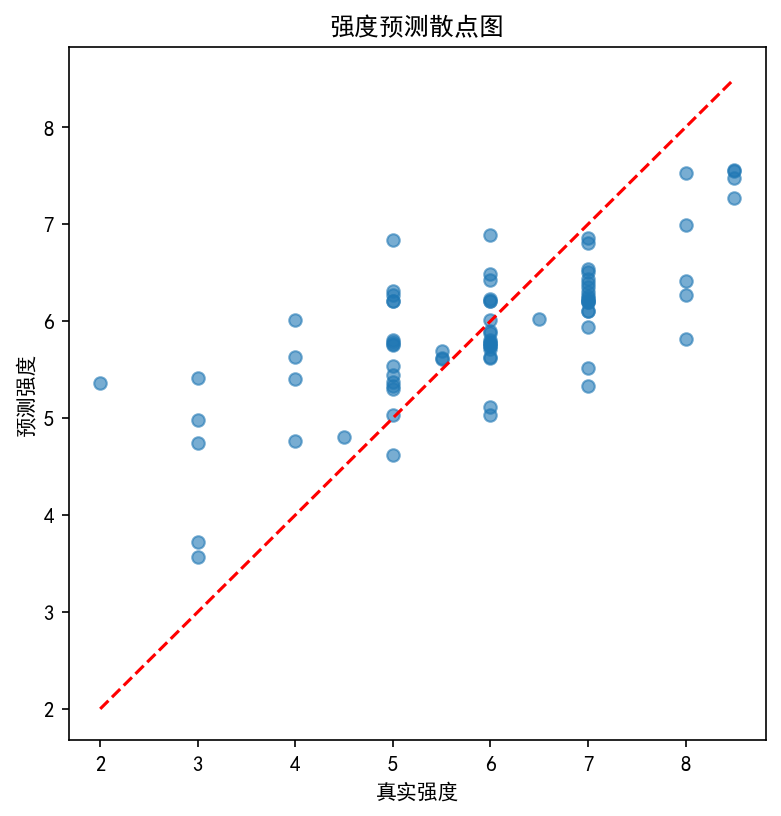
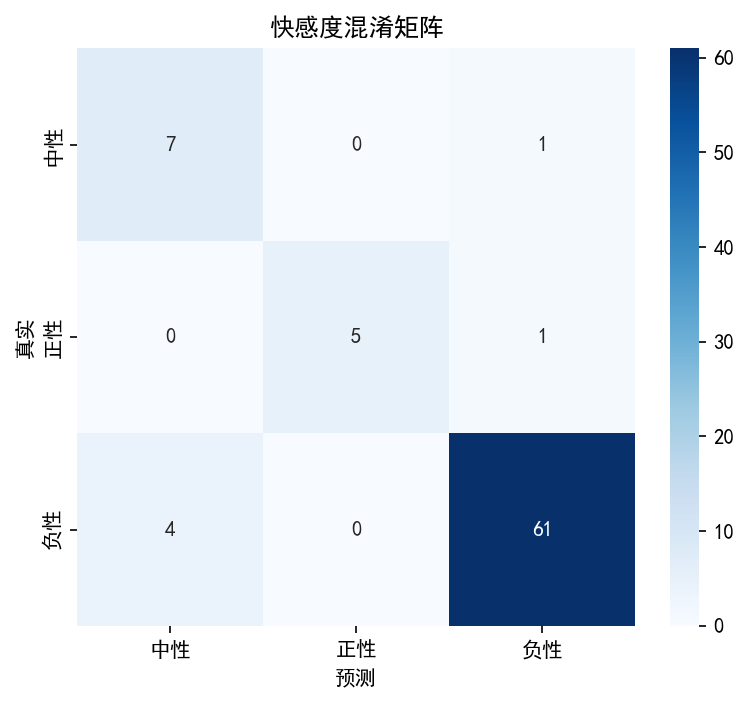
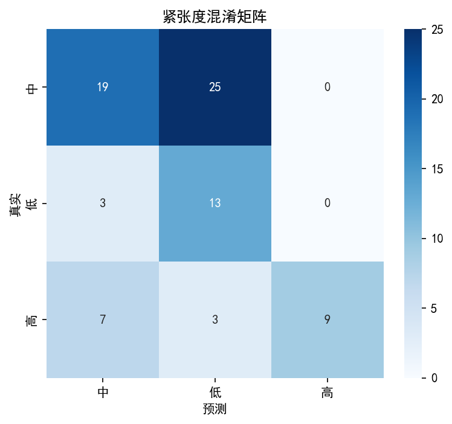
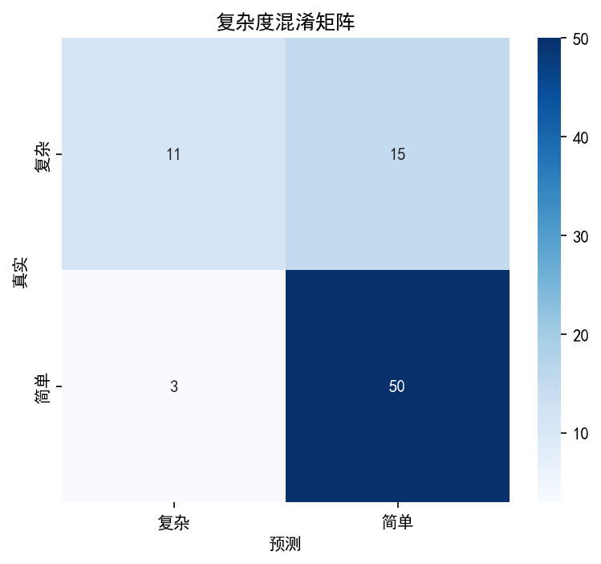

# 模型评估报告

**生成时间**: 2026-03-18 14:20:48

## 强度回归

- **MAE**: 0.79



## 快感度分类

```
              precision    recall  f1-score   support

          中性       0.64      0.88      0.74         8
          正性       1.00      0.83      0.91         6
          负性       0.97      0.94      0.95        65

    accuracy                           0.92        79
   macro avg       0.87      0.88      0.87        79
weighted avg       0.94      0.92      0.93        79

```



## 紧张度分类

```
              precision    recall  f1-score   support

           中       0.66      0.43      0.52        44
           低       0.32      0.81      0.46        16
           高       1.00      0.47      0.64        19

    accuracy                           0.52        79
   macro avg       0.66      0.57      0.54        79
weighted avg       0.67      0.52      0.54        79

```



## 复杂度分类

```
              precision    recall  f1-score   support

          复杂       0.79      0.42      0.55        26
          简单       0.77      0.94      0.85        53

    accuracy                           0.77        79
   macro avg       0.78      0.68      0.70        79
weighted avg       0.77      0.77      0.75        79

```



