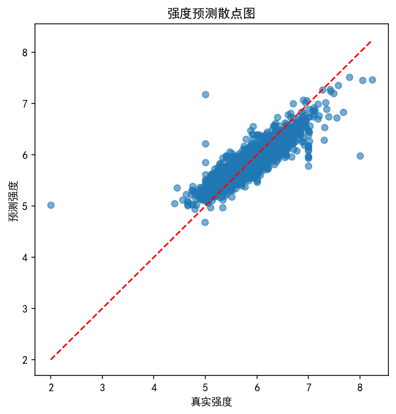
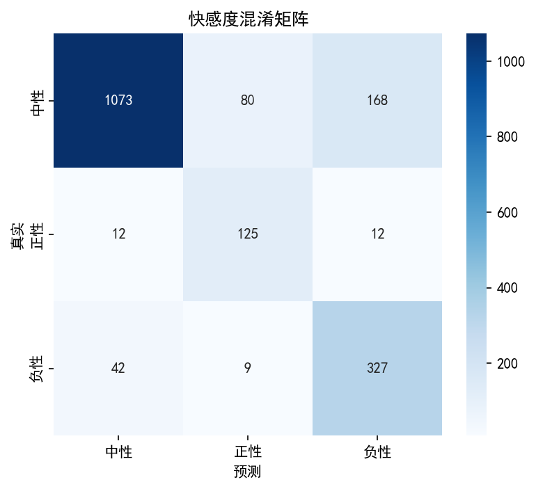
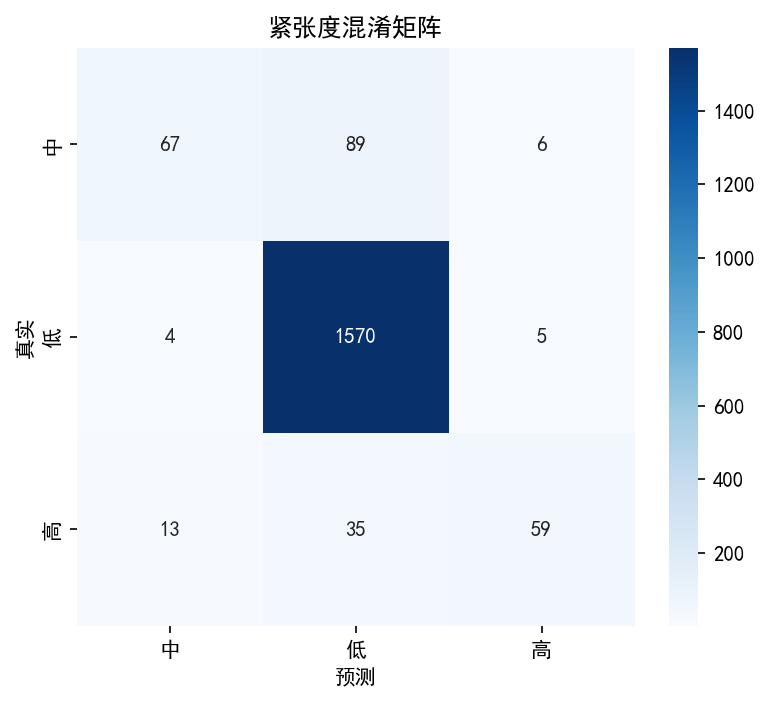
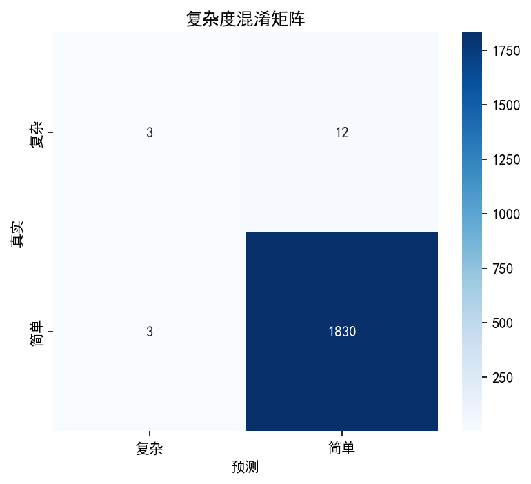

# 模型评估报告（仅使用 human 和 ai 数据）

**生成时间**: 2026-03-19 13:29:05

**训练数据构成**: 人工 9239 条, AI 数据 925 条
**测试集**: 人工数据中的 1848 条（20%）

## 强度回归
- **MAE**: 0.19



## 快感度分类
```
              precision    recall  f1-score   support

          中性       0.95      0.81      0.88      1321
          正性       0.58      0.84      0.69       149
          负性       0.64      0.87      0.74       378

    accuracy                           0.83      1848
   macro avg       0.73      0.84      0.77      1848
weighted avg       0.86      0.83      0.83      1848

```



## 紧张度分类
```
              precision    recall  f1-score   support

           中       0.80      0.41      0.54       162
           低       0.93      0.99      0.96      1579
           高       0.84      0.55      0.67       107

    accuracy                           0.92      1848
   macro avg       0.86      0.65      0.72      1848
weighted avg       0.91      0.92      0.91      1848

```



## 复杂度分类
```
              precision    recall  f1-score   support

          复杂       0.50      0.20      0.29        15
          简单       0.99      1.00      1.00      1833

    accuracy                           0.99      1848
   macro avg       0.75      0.60      0.64      1848
weighted avg       0.99      0.99      0.99      1848

```



